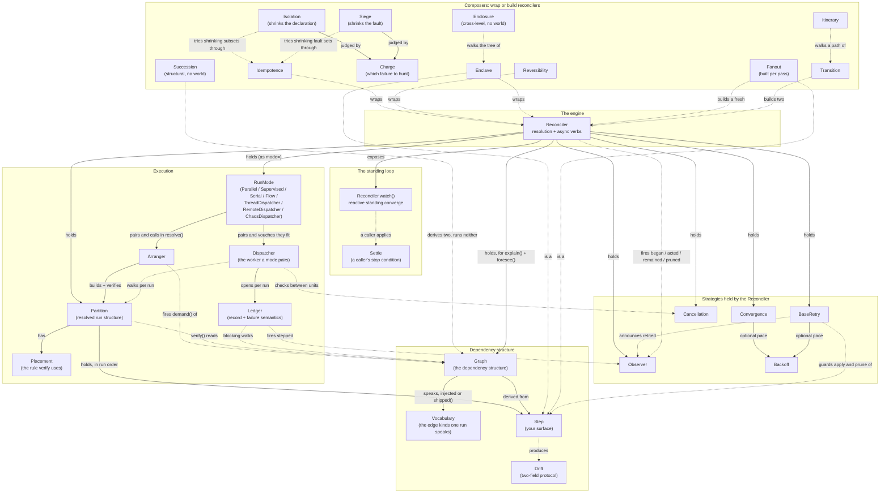
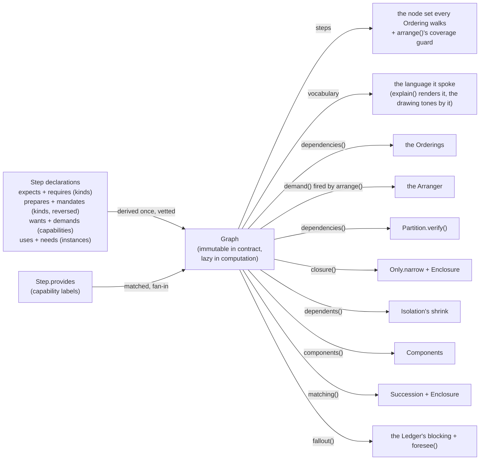
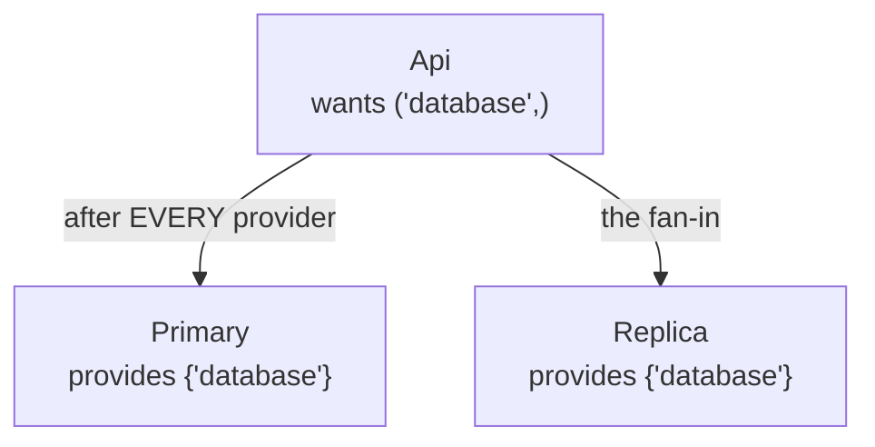
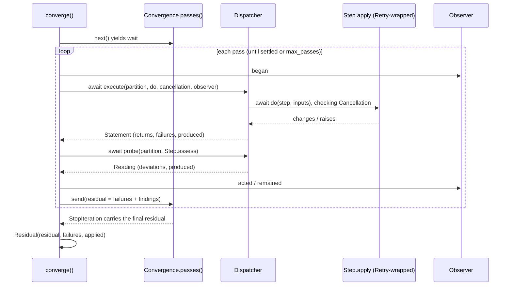

# Architecture

How the kernel is put together - who holds whom, what consumes what and how a `converge()` runs.

`cabaxiom` is a **composition** kernel. A `Reconciler` owns no domain logic of its own. It takes the `Step`s you hand it plus a set of injected strategies, resolves them once into a single verified `Partition`, then drives the self-verifying apply -> re-probe -> residual loop. Every axis of behaviour is a small object you swap and every seam is a public override point on a base you subclass - abstract where the kernel has no sane default, a working no-op where it does. The engine is async to the bone. There is no sync twin, `converge()` and the reads are coroutines and a plain synchronous `Step` still runs inline.

## The spine

Six names carry the whole story - everything else in this document hangs off one of them.

```text
Steps  ->  Graph  ->  Ordering  ->  Partition  ->  Dispatcher  ->  Ledger
declare    derive     linearise     the shape      run it        record it
                                   \____ the RunMode pairs these two ____/
```

**Steps** declare what they depend on (`expects`, `requires`, `wants`, `demands`, `uses`, `needs`), what they come before (`prepares`, `mandates`) and what they offer (`provides`). The **Graph** derives that structure ONCE - every edge kind, vetted, total. The **Ordering** linearises the graph it is handed and that graph is the WHOLE of what it is handed. The derivation carries the run's membership alongside the edges over exactly that membership, so the strategy only chooses a valid order through a structure that already exists, creating nothing. The **Partition** is the resolved run shape (waves or chains) the reconciler holds. The **Dispatcher** walks it - fanning each wave onto the event loop with `asyncio.gather`, onto worker threads for a blocking domain or step by step as each one's own prerequisites settle. A caller never assembles that worker by hand. A `RunMode` pairs it with the Arranger whose shape it can walk and vouches for the two. The **Ledger** records what every write returned, what failed and what a failure blocked, under the kernel's one failure rule. The rest of the vocabulary (Arranger, Placement, Convergence, Retry, Cancellation, Observer, Scope, Settle) tunes or guards one of these six and each is introduced where its spine element is.

## Composition (who holds whom and who tells whom)



Solid arrows are ownership (holds, composes, builds) and dotted arrows are collaboration (is a, wraps, fires, checks, walks) - the leaves and composites stay in the table and the prose, the diagram carries every AXIS-level relation. The load-bearing "has-a" chain: **a RunMode pairs an Arranger with a worker, the Arranger builds a Partition, the Partition carries a Placement.** Three responsibilities, three objects. The Arranger PLANS, the worker RUNS and the RunMode PAIRS them and proves the worker can walk what the Arranger built - `resolve()` builds the shape and then guards the partition that actually came back, at construction, before any world is read. Nothing here checks a promise against a promise, which is why an earlier design binding two DECLARED overlaps was refused. The worker never interprets an Ordering and never carries a shape at all, so its contract stays exactly `execute()` and `probe()` and a decorator can wrap one without proxying an arranger - which is what dissolved that proxy in 0.6.0. A `Backoff` is shared by `Convergence` (Fixpoint's retries) and `Retry` (a step's write attempts). Composites nest their own type: a `Quorum` holds `Cancellation`s, a `Chorus` holds `Observer`s, a `Jitter` wraps another `Backoff`. `Reconciler.watch()` is the standing converge - a converge per wake from the steps' own `watch()` event sources - and a caller applies a `Settle` to decide when to stop it; `Idempotence` wraps a reconciler to prove a second converge is a clean no-op; `Reversibility` wraps one to prove the converge -> prune round trip restored the world to its first observed reading; `Enclave` wraps one INTO a `Step`, so whole stacks nest fractally; `Transition` builds two reconcilers to move a world between declarations (prune the leavers, converge the rest); `Enclosure` walks a whole enclave TREE and mints a `Severance`, naming every ordering a boundary voids because each level derives its Graph over its own selection alone; `Succession` reads the same two declarations a `Transition` moves and mints a `Rift` over the derivation's delta, the silent `quieted` channel naming every soft edge that lost its whole match set - the only composer that touches no world at all; `Itinerary` walks a whole PATH of declarations one proof-gated Transition per hop, advancing only on a clean Cutover, with `reversed()` as the rollback; `Isolation` builds trial reconcilers over shrinking dependency-closed subsets, running each through the idempotence protocol until the injected `Charge` convicts the smallest group still showing the failure; and `Siege` is its twin on the other axis, holding the declaration still and shrinking the FAULT instead - it lays a `Targeted` strike on every step and lifts them one at a time, minting a `Breach` naming the smallest fault set the declaration cannot take. Every dispatcher opens a `Ledger` per run - the record of what the writes returned, what failed and what a failure blocked, plus the one raise-or-collect rule and the live `stepped` hook. It is handed the RUN's derivation rather than deriving one of its own, so the set a failure blocks and the set `foresee()` predicts are one walk over one graph. The Ledger never escapes its dispatcher. `execute()` hands back its `outcome()` as one `Statement` - the returns, the failures and what each settled step PRODUCED - so the record is returned, never reached into and the artifacts leave the run instead of dying with the Ledger that kept them. And the dependency structure itself lives in one home, the Graph. The reconciler derives it ONCE over the post-scope selection and hands it down as the WHOLE input, membership included and read as `graph.steps`, the arranger opens `arrange()` by firing `demand()`, the Orderings order through `dependencies()`, `verify()` checks placements against the same instance, `Only` grows its closure with its own (pre-narrow) one and the Ledger walks its lazy inversion to block a failure's dependents - one derivation per resolution, every guard total by construction. The shared bases are public and named `Base*`: `BaseDispatcher` (the worker base holding the failure policy and the Ledger factory), `BaseFan` (under `Waves`/`Chains`/`Walk`), `BaseLooping` (under `Fixpoint`/`Shrinking`), `BaseRetry` (under `Retry`) and `BaseNamed`/`BaseTagged` (under the type and tag scopes). `WavesDispatcher` is the concrete base the wave-fanning dispatchers (`Parallel`, `Supervised`) stand on. Its `execute` is a sealed `@final` guard holding the wave barrier, its `run_wave` the seam each fills. `ThreadDispatcher`, `RemoteDispatcher` and `ChaosDispatcher` sit apart as run modes composing pure WORKER decorators, delegating the wave mechanics to the worker each wraps - the thread bridge wraps the write in `asyncio.to_thread`, the wire ships it as an envelope, the chaos axis poisons it - so each threads, ships or sabotages a `Parallel` or a `Supervised` run without duplicating either and the wave guard stays sealed. Because a decorator declares `Overlap.NEITHER` truthfully (it fans nothing ITSELF), the pairing guard asks the PAIR through a `walks()` seam each decorator overrides or wrapping would launder a mismatch straight past it. `Serial` and `Flow` are the two modes that lean on no seating at all - the first because it overlaps nothing, the second because it declares `Overlap.EDGES` and governs its own concurrency from the Graph, awaiting each step's own prerequisites and holding its own contention locks.

## The swappable strategies

| Axis | Base | Built-ins | Question it answers |
| --- | --- | --- | --- |
| Scope | `Scope` (`BaseNamed`, `BaseTagged`) | `Only`, `Skip` (by type, seam `narrow`); `WithTag`, `WithEveryTag`, `WithoutTag` (by tag, seam `keeps`) | Which handed steps take part? |
| Ordering | `Ordering` | `Kahn`, `DFS`, `Priority`, `Components` | In what order, given `expects`/`requires` (kinds), `prepares`/`mandates` (kinds, reversed), `wants`/`demands` (capabilities) and `uses`/`needs` (instances) - each pair soft and hard? |
| Arranger | `Arranger` (`BaseFan`) | `Waves`, `Chains`, `Walk` (the serial-safe shape) | How does an Ordering become the Partition a worker walks? |
| Partition | `Partition` | `WavesPartition`, `ChainsPartition`, `WalkPartition` | The resolved run structure, self-verifying via `Placement` over `Seat`s. |
| Run mode | `RunMode` | `Parallel` (waves gathered on the loop), `Supervised` (waves, cancellation polled mid-flight), `Serial` (one step at a time, deterministic), `Flow` (barrier-free, each step starts when its OWN prerequisites settle), `ThreadDispatcher` (blocking bridge via `asyncio.to_thread`), `RemoteDispatcher` (the wire), `ChaosDispatcher` (fault injection) | Which shape does this run take and which worker walks it? |
| Dispatcher | `Dispatcher` / `WavesDispatcher` (seam `run_wave`) | the private workers a run mode pairs with, plus any you write | How is one group of work actually run? |
| Convergence | `Convergence` (`BaseLooping`) | `Once`, `Fixpoint` (stops on a stall OR an oscillation), `Shrinking` (stops when the residual stops getting smaller), `Budget` (loops while there is time on a clock) | How many apply -> re-probe passes? |
| Backoff | `Backoff` | `Fixed`, `Exponential`, `Linear`, `Fibonacci`, `Jitter` | How long to pause before a retry? |
| Retry | `BaseRetry` | `Retry` (the @final retry-everything leaf), seam `retryable(step, attempt, error)` | How many tries does one write get and which failures earn them? |
| Cancellation | `Cancellation` | `Deadline`, `Flag`, `Quorum` (+`Rule`: `Some`/`Every`/`Most`), `AnyOf`/`AllOf`/`Majority` | When to abort cooperatively? |
| Quorum rule | `Rule` | `Some`, `Every`, `Most` | How does a Quorum fold its members' fired-or-not states into one answer? |
| Settle | `Settle` | `Clean`, `Stable` | How many `watch()` passes before the caller stops the loop? |
| Observer | `Observer` | `Chorus`, `Journal`, `Logging`, `Timing`; pass hooks `began`/`acted`/`remained`/`pruned` + live unit hooks `dispatching`/`stepped`/`produced`/`retried` (the READ phase announces through `dispatching` too, so a plain `assess()` is not a blank trace but never through `produced` - a re-probe's usually-empty reading would overwrite the write's lineage) | How to trace or record a run without touching a Step? |
| Charge | `Charge` | `Churn`, `Stall` | Which failure is an `Isolation` or a `Siege` hunting, judged over a trial's `Proof`? |
| Adversary | `Adversary` (`ChaosDispatcher` composes one) | `Sabotage` (drops, aborts and delays from configured rates, over an injected `rng` so a run replays), `Targeted` (strikes exactly the steps it was handed, the deterministic one a `Siege` can shrink) | What fault does the run inject, to exercise its own failure semantics? |
| Vocabulary | `Vocabulary` | `Vocabulary.shipped()` (expects/requires, prepares/mandates, wants/demands, uses/needs), grown via `grown()` with `EdgeKind` rows over `BY_CLASS`/`BY_LABEL`/`BY_INSTANCE` addressing | Which edge kinds does this run speak and how does each declared name find what it means? |

`Step` is your surface. It declares dependencies in soft-and-hard pairs (`expects` / `requires` on kinds, `prepares` / `mandates` the same kind edge written the other way around - the declarer runs first, `wants` / `demands` on capabilities matched against what other steps declare through `provides` and `uses` / `needs` on instances) and tags (`tags`, opaque labels a tag scope selects on). It also declares its DATA plane - `produces` names the artifact keys its hooks write, `consumes` the keys they read - which creates no order at all, because a step may well come after another for reasons that carry no payload. What it buys is a guard and it answers the world through one read hook `assess(inputs) -> (Assessment, Artifacts)`, the writes `apply`/`prune` and the reactive `watch()`. The `Assessment` carries four channels - `deviation`, `plan`, `advisory`, `footprint` - from a single probe. `Drift` is a structural protocol (two fields, name + message); `DriftItem` is the ready-made carrier.

## The Graph, one home for the dependency structure



The Graph is the Ledger's twin on the dependency axis. Where the Ledger owns what a run RECORDED, the Graph owns what a run is MADE OF. Derivation is total - an edge naming something absent is a dead end, never an error - and construction VETS every declaration, so a value in the wrong slot (a label in `expects`, a class in `uses`) is a TypeError naming the slot the stray belongs in. It also PUBLISHES the membership it was derived over, as `graph.steps`, which is what lets every consumer downstream take the derivation ALONE: the set and the edges over it used to travel as two separate arguments through the whole spine and nothing checked they described the same world, so a mismatched pair surfaced as a raw KeyError from inside a placement check or as a coverage error blaming an Ordering for a fault that was never its own. One argument cannot disagree with itself. The one presence rule lives apart as `demand()`, fired by the arranger's `arrange()` on the post-scope set before any Ordering verb runs - `requires` or `mandates` naming an absent class, `demands` naming an unprovided capability or `needs` naming a missing instance, raises there and no custom strategy can forget it. `arrange()` is concrete and fires it before the shape seam runs at all, so a custom Arranger inherits the rule rather than being trusted to repeat it. Inversion and closure are computed on first use and cached, the Ledger's clean-run-pays-nothing discipline and `matching()` is lazier still. It keeps NOTHING, re-running the same lookups against the tables `demand()` already retains, so the per-name view with its misses costs a run that never asks exactly nothing. And the kinds themselves are DATA: each is an `EdgeKind` row (its slot, its `Addressing` strategy - by class, by label or by instance - its hardness, counterpart, colour and direction), collected into the `Vocabulary` a run speaks, injected like every axis with `Vocabulary.shipped()` as the default the Graph mints when handed none. Because every consumer reads this one home AND its one table, a new edge kind lands as one row and nowhere else - proven by a grown kind that derives, matches, classifies, explains and draws with no consumer edited.

### Identity and the wire

A Step's identity is the INSTANCE and it is deliberately process-local. Every structure the kernel derives is keyed by it - two instances of one kind are two nodes and the Graph refuses a step whose class rewrote `__eq__` precisely because value equality would collapse two nodes into one. ACROSS declarations there is a second rule, because instance identity has nothing to compare when the successor was rebuilt from data rather than shared. `Step.paired` is the one home for that question and it recognises a step by the `identifier` it calls itself where it has one, falling back to object identity where it does not - so Transition's leavers and Succession's delta agree on who survived and a declaration written before identifiers existed behaves exactly as it always did. A "network-stable" identity grafted onto `__eq__`/`__hash__` would buy the wire at the price of all of that - two unrelated instances minted the same label would compare equal and a label minted after construction would change a step's hash under every container already holding it.

So the wire is a BOUNDARY problem and it is solved at the boundary - and SHIPPED there, as `RemoteDispatcher(transport)`, a decorator (the ThreadDispatcher pattern) whose transport ships `(verb, step, inputs)` out, lets the deserialized clone do the work and takes the outcome back on the call's own stack - or by a token the dispatcher itself minted, on a queue-shaped transport. The worker half is `RemoteDispatcher.work()`, one envelope in and one reply out and the verb crosses because the reconciler hands `execute()` a `Write` - the retry-wrapped callable with its verb spoken, whose `rewire()` lays the run's retry over the transport call so attempts are spent on wire crossings. Nothing forces a Step to travel back at all. The reply payload is `Changes` plus `Artifacts`, plain data by type and `DriftItem` reconstructs through its own constructor so the kernel's currency crosses in both directions. The ORIGINAL step keys the Graph and the Ledger throughout, so the clone never touches either and the frozen Step is what makes the crossing safe. The clone lands with its declaration intact and the freeze still armed. Process-local identity is also the fence against a stale reply - a redelivered outcome from an earlier run CANNOT key a live map, where a global identity would let it poison one silently - and the Ledger holds that fence loudly. `record()` refuses a step that is not the run's own, because artifacts stored under a foreign key would vanish from every dependency read while the run reported clean. `tests/test_wire.py` pins the doctrine - the boundary pattern converges cleanly with a pickle round trip as the transport in both directions, a returned clone used as a Graph key is the KeyError it looks like and the Ledger's refusal names the fix - and `tests/test_remote.py` pins the shipped leaf, protocol guards included.

### The capability edge, fan-in by construction



Duplicate providers are a fan-in, not a conflict. A capability dependency orders after every present provider, exactly as `expects` treats two instances of one kind and the kernel never picks among them. `wants` is the soft flavour (an unprovided capability is a dead end, trusted to the world), `demands` the hard one (absence raises at resolution). The kernel never interprets a capability - it only matches it.

## Construction (once) - strategies in, one verified Partition out

```mermaid
graph LR
    S["tuple[Step]<br/>expects + requires + prepares + mandates<br/>wants + demands + uses + needs"] -->|"derived once, vetted,<br/>speaking the injected vocabulary (SSOT)"| BG["Base Graph<br/>(the full world)"]
    BG -->|"Scope.select()<br/>(transforms Graph -> Graph)"| GR["Scoped Graph<br/>(the edges AND the membership:<br/>the whole input from here on)"]
    GR -->|"the Ordering LINEARISES it, handed the Graph ALONE<br/>(arrange() fires demand() first)"| O["run order"]
    O -->|"the arranger's shape"| P["Partition<br/>(Waves / Chains / Walk)"]
    P -->|"covers() + verify() against that same Graph,<br/>membership included"| V["held by the Reconciler"]
```



`Scope` and `Ordering` are **consumed once** at construction, not kept. What the Reconciler holds afterwards is the finished, verified `Partition` (plus the RunMode it was handed as `mode=` and the Convergence, Retry, Cancellation and Observer). A base Graph is derived ONCE over the raw handed steps locking in the vocabulary (the SSOT). Then `Scope` acts as an endofunctor (`Graph -> Graph`), transforming the full world into the scoped Graph and handing it down as the ONLY input, so the Ordering, the coverage guard and `verify()` all read the same structure. Because the derivation carries its own membership (`graph.steps`), not one of them can be handed a set and a derivation describing different worlds. The guards stack here. The Graph VETS every declaration as it derives (a wrong-slot value is a TypeError naming the right slot) and enforces the IDENTITY contract no class hook can see (two value-equal steps would collapse into one node, so the dataclass case is refused here, naming `eq=False`), `arrange()` opens by firing `demand()` - the hard edges (`requires`, `mandates`, `demands`, `needs`) enforced on the post-scope set, in concrete code no subclass writes - `demand()` also carries the DATA plane's own rule, refusing a step that consumes an artifact key no PREREQUISITE of it produces - the payload is mounted from a step's direct prerequisites, so a key nothing upstream produces would arrive as an absent entry the hook cannot tell from a real one and the run would report clean against a world nobody supplied; `verify()` rejects a mis-split that would ignore an edge under a fanning worker, the membership check rejects an Ordering that dropped or duplicated a step and the RunMode's own guard rejects a worker that cannot walk the shape it was paired with. Every one of these refusals has a NAME. `Malformed` (a TypeError) is a declaration of the wrong shape, `Unresolvable` (a ValueError, with `Cycle`, `Coverage`, `Seating`, `Pairing`, `Presence`, `DataFlow` and `Identity` under it) is one well formed and still not a run and `Misconfigured` (a ValueError) is an axis handed a value outside its own domain. The three share no root on purpose, since a caller who wants to hear about one has no business being handed the other two and each subclasses the built-in it replaces so existing handlers keep working.

## converge() (per pass)



The **policy** (how many passes, how to back off) lives once in `Convergence.passes()`, a generator `converge()` drives; the pause it yields is `await asyncio.sleep`, so a paced retry never blocks the coroutines sharing the loop. Each pass runs the write phase through the `Dispatcher` (which checks `Cancellation` and fires the `Observer`), then re-probes `assess()` for the residual's deviation channel. The write callable goes in already wrapped in the injected retry by the reconciler, as a `Write` that also speaks its verb. The dispatcher stays blind to the attempt logic (the one exception is the wire, which `rewire()`s the same budget over its own crossings), yet the attempts are spent inside its own unit of work - a coroutine write awaits its paced retries on the loop and `ThreadDispatcher`'s worker retries its blocking write on the thread it runs on. An empty `Residual` means the kernel acted, probed again and confirmed the world matches intent - and the record is FROZEN, like every verdict the kernel mints. The changes made along the way ride the separate `applied` channel, so "what I fixed" never blurs into "what is still wrong" and this run's failure records ride `failures`, so "did anything break" stops being a message-prefix hunt through the flat view. An abort cuts through it all as a `BaseException`. A domain hook's `except Exception` cannot swallow a `Cancelled` and an async wave cancels its mates eagerly the moment a step raises one - an abort is a decision and decisions do not wait.

The one read hook `assess()` (and the re-probe that proves a converge) fans through the same dispatcher via its `probe()` - gathered per wave under `Parallel`/`Supervised`, run on worker threads under `ThreadDispatcher`. A coroutine `assess()` is a legal, typed override - the hook declares the possibly-awaitable `FlowAssessment`, so `async def assess()` closes its gap over I/O and a plain `def assess()` runs inline. A broken fanned probe settles its whole wave first - nothing left running detached on the loop - then every failure raises together as one native `ExceptionGroup`, the read twin of the write barrier, so one diagnostic pass surfaces every broken read at once and a `Cancelled` cuts through the sift alone. Under `BestEffort`, a failed step's transitive dependents are not run. The `Ledger` reports each as `step blocked` drift, distinct from `step failed`, so the residual reads as a causal chain. Under `Halt`, nothing further starts at all. Every unrun step is reported as `step skipped` naming the culprit and the run returns its record instead of raising - stop like `FailFast`, report like `BestEffort`, the third corner of the policy square.

## The loop and the proof

A `Reconciler` converges once. `Reconciler.watch()` is the standing converge that keeps it converged. Each `Step` can expose an async `watch()` that yields whenever its own world may have moved - a file event, a queue message, a webhook - and the engine answers every wake with a full converge, yielding the residual. Level-triggered to the bone. A wake carries no payload and is never trusted as a report, so a spurious wake costs one clean pass and a missed one is caught by the next. It runs until the caller breaks out of the loop; a `Settle` is the reusable stop condition the caller applies, a generator primed then fed each pass's residual (`Clean` on the first clean pass, `Stable(k)` only after `k` consecutive clean passes, so a flapping resource does not fool it) - the same generator shape as `Convergence`, one loop policy written once.

`Idempotence` wraps a reconciler and proves the promise the kernel is built on. It converges, converges once more and returns a `Proof` whose `stable` holds only when that second converge changed nothing (`churned` empty) and left nothing still wrong (`residual` empty) - the churn being what an `apply()` that keeps working under a clean `assess()` reveals, which no single converge would.

`explain()` says what the run WILL do. `foresee(step)` says what it would LOSE if that step failed, minting a `Casualty` whose `blocked` channel is the Graph's `fallout()` - the literal walk the `Ledger` runs when it blames a real failure, so forecast and handling cannot disagree. `Halt` is reported apart from it, as `skipped` (a strictly later wave, which no dispatcher can start once the run stands still) and `settling` (the failure's own wave, admitted whole and in flight so its members settle rather than skip), because Halt gates by run POSITION and not by edges.

`Enclave` closes the composition on itself. The Step surface and the reconciler surface align verb for verb, so a whole reconciler joins a parent run as ONE step and reconciliation is fractal. The load-bearing rule is in its `apply()`, which returns the inner converge's APPLIED channel, never the residual - what is still wrong inside surfaces through the parent's re-probe, since `assess()` delegates, keeping "empty means verified" true across levels. `Fanout` is its dynamic sibling and the difference is WHEN the inner graph exists. An enclave holds one that was resolved at construction, a fanout answers a fresh one from `explore()` on every verb, so a declaration naming one concern covers however many things the world holds at that moment. Each discovery is its own step, so it is its own finding under its own name and spends its own retry budget and the graph is rebuilt WHOLE rather than mutated - which is what keeps every pass a complete immutable derivation that `Idempotence` can certify. Its three verbs are sealed for the same reason the enclave's rule is load-bearing and `Enclosure` refuses to walk it by name rather than reporting airtight over a boundary that does not exist yet. And `Transition` moves a world between declarations without a state store. It prunes exactly the steps present before but absent now (their own reverse order, teardown first to make room), converges the desired set and returns both proofs as one `Cutover`.

## Extension seams

### Two kinds of base and only one of them is a slot

Almost every public base is named `Base*` or is an axis protocol, which makes them look like one family. They are two and mixing them up is the difference between extending the kernel and fighting it. The cut that matters is ROLE, not mechanism. Whether a name appears as a CONSTRUCTOR PARAMETER somewhere is what decides it and being an ABC does not.

| Kind | What it means for you | Members |
| --- | --- | --- |
| **Axis** | A slot a composer declares as a parameter. Implement it and INJECT the result. This is the whole extension model. | `Scope`, `Ordering`, `Arranger`, `Partition`, `RunMode` (the reconciler's own `mode=` slot), `Dispatcher` (the RunMode's), `Convergence`, `Backoff`, `BaseRetry`, `Cancellation`, `Rule`, `Settle`, `Observer`, `Charge`, `Adversary`, `Vocabulary` |
| **Base under an axis** | NOT a slot. Subclass it to inherit a family's guard and plumbing, then inject what you built AS its axis type. | `BaseNamed`, `BaseTagged` (under `Scope`), `BaseLooping` (under `Convergence`), `BaseDispatcher`, `WavesDispatcher` (under `Dispatcher`), `BaseFan` (under `Arranger`), `BaseRetry` (under itself, the retry axis), `Quorum` (under `Cancellation`) |

`Step` sits outside both. It is your surface, not a strategy and the thing every other row exists to serve.

Two consequences worth stating, because both surprise people. **You never inject a `Base*` from the second row.** A `Reconciler` declares `scope: Scope` and `convergence: Convergence`, so `BaseNamed` and `BaseLooping` are places to stand while you build one, never the type a slot accepts. And **the async collapse deleted the whole third kind this table used to carry** - a "colour-pair base" that existed only so a sync twin and an async twin could share everything that was not `await`. There is one engine now, so there is one `Reconciler`, one worker family, one `Idempotence`, one of each composer. The seam to extend is the strategy you inject, never a twin to mirror. A blocking domain does not get its own reconciler - it rides the async engine through `ThreadDispatcher`.

### The seams themselves

Every override point a subclass implements is a PUBLIC METHOD, uniformly - `narrow` (type scopes), `keeps` (tag scopes), `placement` (partitions), `run_wave` (waves dispatchers), `deciding` (looping convergences), `retryable` (retry) and `shape` (arrangers) sit beside the already-public `execute` / `passes` / `watch` / `cancelled`. Each guard is `typing.final`, so a type checker refuses an override of the guard while the seam stays open - the pairing is a checked claim rather than a docstring promise, which matters because an abstract entry point once let a four-line Arranger skip the hard-presence rule entirely. The kernel's invariants are held by that public GUARD each seam sits behind - `select` verifies presence before it narrows, `arrange` fires the hard-presence rule, the coverage guard and the placement check around a `shape()` that only builds - and the rule it checks against comes from the Partition that seam RETURNS, so a shape cannot claim one rule and hand back another, exactly as the Graph is the whole INPUT to every spine verb, so a caller cannot claim one membership and hand down a derivation of another; `verify` checks a placement, `execute` drives the loop through the `Ledger`, `BaseLooping.passes` primes and bounds the multi-pass loop around a fresh `deciding()`, `BaseRetry.__call__` drives the attempt budget - so the entry point can be public because the kernel always enters through the guard, never the raw seam. The seams are abstract, since an engine has no business guessing its policy. Where an honest default exists it ships as a @final LEAF instead of a defaulted method body - `Retry` (retry every failure) stands under `BaseRetry` exactly as `Fixpoint` stands under `BaseLooping`, so the family works as handed while ABCMeta refuses a policy that forgot to answer the question at all. `BaseRetry`'s attempt loop is concrete (the `Cancelled` cut-through is STRUCTURAL - an abort is a `BaseException` no attempt loop's except can even catch), so the seam it exposes is `retryable(step, attempt, error)` - exactly the triple `Observer.retried` announces, since they are the same event asked and told. Seeing the step and the count is what lets ONE injected Retry serve a run whose steps do not deserve the same number of tries. Declining at a given attempt caps the spend for that step alone and the cut attempt pays no pause. The pace stays global, one `Backoff` for every attempt this Retry paces. The dispatcher axis keeps the pairing intact. `WavesDispatcher.execute` is the sealed `@final` guard (the wave barrier, the between-wave cancellation check and the Ledger recording), `run_wave` its abstract seam - and `ThreadDispatcher` gets its thread bridge not by overriding that guard but by DECORATING an underlying dispatcher, so nothing reaches into the sealed loop. The `Diagram` axis follows the guard/seam shape one axis over. `render()` is the sealed walk (node identity, grouping, arrow order - facts about the RUN no format may answer differently) and its four syntax seams (`opening`, `grouped`, `arrow`, `closing`) are the way in, with `arrow` handed the tone derived from the run's own vocabulary, so a format renders a kind it has never heard of. `Drift` is a protocol, satisfied structurally, never subclassed. And `Step` seals its identity outright - a hand-written `__eq__` or `__hash__` is refused at class definition, because every structure the kernel derives is keyed by instance and value equality would quietly collapse two steps into one node. It is also frozen after construction. A step is a declaration, so its state lives in the run (returned as artifacts, read from `inputs`) rather than accumulating on `self` between passes.

## In one sentence

`Reconciler` is a composer. It takes your `Step`s and the injected strategies, turns them into one verified `Partition` at construction (the Graph deriving and vetting every edge kind on the way) and `converge()` drives `Convergence.passes()` which, through the worker its `RunMode` vouched for (running the `Retry`-wrapped write on the event loop, under `Cancellation`, reporting to the `Observer`), delivers a `Residual` whose emptiness is the proof the run worked.

